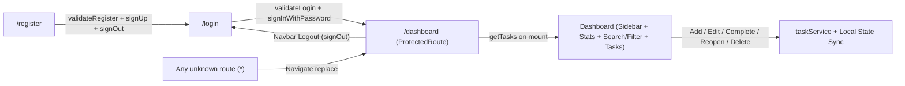

# Application User & Tech Flow

This document traces the complete end-to-end user journey and technical data flow from registration through logout, matching `ToDo_App_Build_Guide.pdf`.

## End-to-End Flow



## 1. Registration (`/register`)

1. If an authenticated user visits `/register`, they are redirected immediately to `/dashboard`.
2. User enters **Name**, **Email**, **Password**, and **Confirm Password**.
3. Client-side validation (`validateRegister` in `frontend/src/utils/validators.js`) checks:
   - `name`: required, at least 2 characters
   - `email`: required, valid email format
   - `password`: required, at least 6 characters
   - `confirmPassword`: must match `password`
   - Inline errors appear below each field and clear immediately as the user types.
4. On valid submit, the button disables and displays `Saving…`, then calls:
   ```js
   supabase.auth.signUp({
     email: form.email.trim(),
     password: form.password,
     options: { data: { name: form.name.trim() } },
   })
   ```
5. On error (or network failure): displays `toast.error(...)` and re-enables the button safely via `finally`.
6. On success: calls `supabase.auth.signOut()` (guarded by an `isRegistering` ref so `onAuthStateChange` does not briefly flash `/dashboard`), displays `toast.success('Registration successful! Please log in.')`, and redirects to `/login`.

## 2. Login (`/login`)

1. If an authenticated user visits `/login`, they are redirected to `/dashboard`.
2. User enters **Email** and **Password**.
3. `validateLogin` checks required email, valid email format, and non-empty password; inline errors clear on typing.
4. On submit, the button disables (`Saving…`) and calls `supabase.auth.signInWithPassword({ email, password })`.
5. On error: shows `toast.error('Invalid email or password')`.
6. On success: shows `toast.success('Welcome back!')` and navigates to `/dashboard`.

## 3. Session Persistence, Error Boundary & Protected Routes

1. `ErrorBoundary` (`frontend/src/components/ErrorBoundary.jsx`) wraps the application root to catch unexpected rendering errors and show a recovery screen instead of a blank page.
2. On app startup or browser refresh, `AuthProvider` (`frontend/src/context/AuthContext.jsx`) calls `supabase.auth.getSession()` (with `.catch()` fallback so restricted browser storage never hangs loading) and subscribes to `supabase.auth.onAuthStateChange()`.
3. `ProtectedRoute` (`frontend/src/components/ProtectedRoute.jsx`) reads `{ user, loading }` from `useAuth()`:
   - While `loading` is `true`, renders `<Spinner fullPage />`.
   - When `loading` finishes and `user` is `null`, redirects to `/login` with `<Navigate to="/login" replace />`.
   - Otherwise renders `<Dashboard />`.

## 4. Dashboard & Task Management (`/dashboard`)

1. On mount (`useEffect(..., [])`), `Dashboard` calls `getTasks()` from `taskService.js`, showing `<Spinner />` until tasks resolve.
2. **Sidebar & Navbar**: Responsive left sidebar (persistent on desktop `>= 960px`, slide-over drawer with backdrop and `Escape`-key support on tablet/mobile) provides **New Task** focus shortcut, **All Tasks / Pending / Completed** navigation filters with live counts, and user profile info. Sticky top `Navbar` provides the mobile drawer button and **Logout**.
3. **Header & Summary Cards**: Welcome banner displays `"Welcome, {name}!"` (from `user.user_metadata.name || 'there'`), today's date, and live completion percentage. Three `StatCard`s (**Total Tasks**, **Pending Tasks**, **Completed Tasks**) are derived directly from the `tasks` state array.
4. **Search & Filter Toolbar**: Client-side filter tabs (`All`, `Pending`, `Completed`) and real-time search across task titles and descriptions.
5. **Add Task**: Fill Title, Description (optional), Due Date → `validateTask` → `createTask()` → prepends created row to local `tasks` state → `toast.success('Task added')`.
6. **Edit Task**: Click **Edit** on a `TaskItem` → sets `editingTask` and scrolls/focuses `TaskForm` → pre-fills inputs → submit calls `updateTask()` → replaces updated row in `tasks` state → `toast.success('Task updated')`.
7. **Complete / Reopen**: Click **Complete** or **Reopen** → calls `setCompleted(task.id, !task.is_completed)` → updates `tasks` state → shows `'Marked as completed'` or `'Task reopened'`. Completed items show strikethrough text and green status pill; incomplete overdue tasks highlight due date in red.
8. **Delete Task**: Click **Delete** → `window.confirm('Delete this task?')` → `deleteTask(id)` → removes row from `tasks` state → `toast.success('Task deleted')`.
9. **Empty States**: When `tasks.length === 0`, shows `"No tasks yet — add your first one!"`. When tasks exist but search/filter matches nothing, shows `"No tasks match your current search or filter."` with a **Reset Filters** button.

## 5. Logout

Clicking **Logout** in `Navbar` calls `signOut()`, displays `toast.success('Logged out')`, and navigates to `/login`.
