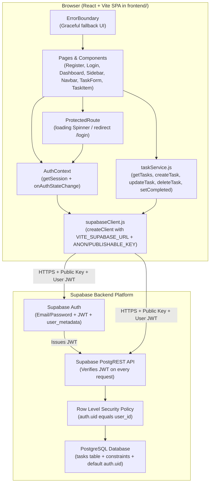

# System Architecture

This application uses a **React (Vite) SPA frontend** communicating directly with **Supabase** (Auth + PostgreSQL + Row Level Security) via `@supabase/supabase-js`. There is no separate Node/Express backend server.

## High-Level Architecture Diagram

## Layer Responsibilities

| Layer | Location | Responsibility |
| --- | --- | --- |
| Error Resilience | `frontend/src/components/ErrorBoundary.jsx` | Catches unexpected React render errors with a recovery reload screen |
| UI Pages & Components | `frontend/src/pages/`, `frontend/src/components/` | Responsive dashboard (Sidebar + Navbar + StatCards + TaskForm + TaskItem + SVG Icons), auth pages, loading spinners, inline errors, and toasts |
| Client Validation | `frontend/src/utils/validators.js` | Instant client-side feedback (`validateRegister`, `validateLogin`, `validateTask`) |
| Auth State | `frontend/src/context/AuthContext.jsx` | Session restoration (`getSession` with error fallback), live auth listener (`onAuthStateChange`), `signOut` |
| Data Access | `frontend/src/services/taskService.js` | All database CRUD calls isolated in one module; never passes or filters `user_id` |
| Supabase Client | `frontend/src/lib/supabaseClient.js` | Single shared `supabase` instance reading `VITE_SUPABASE_URL` and `VITE_SUPABASE_ANON_KEY` (or `VITE_SUPABASE_PUBLISHABLE_KEY`) |
| Database & Security | `database/schema.sql`, `database/policies.sql` | Table schema, NOT NULL / CHECK constraints, `default auth.uid()`, and RLS policy |
| Hosting & Routing | `frontend/vercel.json` | Rewrites all routes to `/index.html` so SPA refreshes on `/dashboard` do not 404 |
